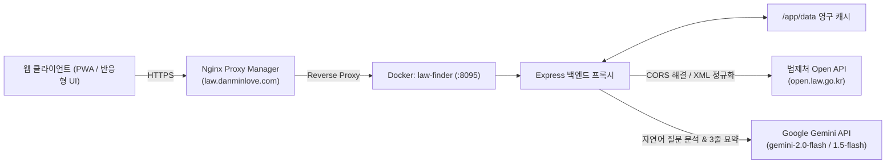

# 기술레포트: AI 하이브리드 판례 검색 & 법률 Q&A 포털 (law-finder)

## 1. 시스템 개요 및 아키텍처

`law-finder`는 대한민국 법제처 국가법령정보 공동활용 Open API와 Google Gemini AI를 결합하여, 일반인이 일상 언어로 법률 질문을 하더라도 최적의 판례와 적용 법조문을 찾아내고 알기 쉽게 해설해 주는 지능형 법률 정보 서비스입니다.

### 시스템 아키텍처 다이어그램

---

## 2. 핵심 기능 명세

1. **판례 통합 검색 엔진**:
   - 키워드, 사건명, 사건번호, 법원별(대법원, 고등법원, 지방법원 등) 다축 필터링 지원.
   - 검색 결과 정렬(선고일자 최신순, 판례명순).
   - 판례 목록 카드 뷰 (사건명, 사건번호, 선고일자, 법원명, 판결유형 뱃지).
2. **AI 법률 질문 & 유사 판례 RAG (옵션 B 구현체)**:
   - 자연어 질문 입력창 제공 ("전세 만기 후 보증금 미반환 시 대처법", "층간소음 손해배상 청구 기준").
   - AI 엔진이 사용자의 질문을 분석하여 표준 법률 키워드, 관련 법률 조문, 분쟁 해결 팁을 도출.
   - 실시간 공공 판례 API 검색 결과와 결합하여 알기 쉬운 요약 가이드 제공.
3. **판례 상세 및 조문 뷰어**:
   - 판시사항, 판결요지, 참조조문, 판례 전문 탭 분리 뷰어.
   - 모바일 바텀시트 / PC 모달 인터페이스.
   - 판례 내용 복사, 북마크(로컬스토리지 저장), 공유 기능.
4. **스마트 Mock Fallback 모드**:
   - API 키 발급 전 또는 외부망 차단 시에도 주요 10대 민생 법률(전세보증금, 사기/보이스피싱, 층간소음, 교통사고 과실, 근로기준법/임금체불 등)의 고품질 실제 판례 데이터셋으로 100% 정상 구동.

---

## 3. 백엔드 REST API 엔드포인트 명세

| 메서드 | 엔드포인트 | 설명 | 주요 파라미터 / 요청 바디 |
| :--- | :--- | :--- | :--- |
| `GET` | `/api/health` | 서버 상태 및 API 키 설정 여부 확인 | - |
| `GET` | `/api/prec/search` | 법제처 판례 목록 검색 | `query`, `page`, `display`, `search` (1:판례명, 2:본문) |
| `GET` | `/api/prec/detail` | 판례 본문 상세 조회 | `id` (판례일련번호) |
| `POST` | `/api/ask` | AI 기반 법률 질문 분석 및 유사 판례 추천 | `{ "question": "질문 텍스트" }` |
| `GET` | `/api/bookmarks` | 북마크 목록 동기화 | - |

---

## 4. 인프라 및 배포 사양

* **호스트 인프라:** Synology NAS DS1019+ (Portainer)
* **포트 할당:** 호스트 `8095` → 컨테이너 `80`
* **네트워크:** `npm_default` (외부 Nginx Proxy Manager와 통신)
* **데이터 영속성:** `lawfinder_data:/app/data` (도커 볼륨)
* **도메인 및 SSL:** `law.danminlove.com` (Let's Encrypt 원스톱 공인 인증서)
* **시간대:** 한국 표준시 (KST, `Asia/Seoul`) 일관 적용
