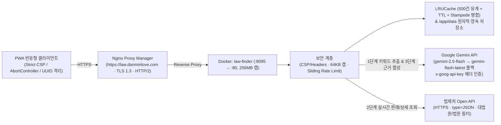

# 기술레포트: AI 하이브리드 판례 검색 & 법률 Q&A 포털 (`law-finder` v2.1.0)

## 1. 시스템 개요 및 아키텍처

`law-finder`는 대한민국 법제처 국가법령정보 공동활용 Open API(**HTTPS + 네이티브 JSON**)와 **Google Gemini 2.5 Flash**를 결합한 **실시간 2단계 RAG(Retrieval-Augmented Generation)** 법률 정보 서비스입니다.

### v2.0.0 고도화 시스템 아키텍처

---

## 2. 핵심 모듈 구조 및 기능 명세

| 경로 | 역할 | 주요 개선 사항 (v2.0.0) |
| :--- | :--- | :--- |
| [server.js](file:///Users/kotinet/Documents/law-finder/server.js) | Express 앱 팩토리(`createApp`), 법제처/Gemini 공통 서비스, REST 라우터 | HTTPS+JSON 전환, `fast-xml-parser` 제거, 2단계 RAG 구현, 외부 연계 판례(`isExternalOnly`) 404 해소, `cleanLawText` 순서 교정 |
| [lib/cache.js](file:///Users/kotinet/Documents/law-finder/lib/cache.js) | 유계 LRU + TTL + 동시 요청 병합 캐시 | 최대 500건 축출, TTL(검색 1h / 상세·메타 7d / AI 6h), `getOrSet` Stampede 방지, 디바운스 비동기 원자적 디스크 백업 |
| [lib/security.js](file:///Users/kotinet/Documents/law-finder/lib/security.js) | 보안 헤더, Rate Limiter, 입력 검증, 격리 북마크 저장소 | `CSP script-src 'self'`, 일반 90/분·AI 10/분 속도 제한, `X-Client-Id`(UUID v4) 기기별 북마크 격리 및 Allowlist 정규화 |
| [lib/explainer.js](file:///Users/kotinet/Documents/law-finder/lib/explainer.js) | 3단계 눈높이 쉬운 판례 해설 및 26종 법률 용어 사전 (v2.1.0) | 중학생·고등학생·대학생/일반 일괄 프롬프트, 판결 방향 오역 방지 가드레일, OWASP LLM05 Allowlist 스키마 검증, 무중단 폴백 생성기 |
| [public/index.html](file:///Users/kotinet/Documents/law-finder/public/index.html) / [app.js](file:///Users/kotinet/Documents/law-finder/public/app.js) / [style.css](file:///Users/kotinet/Documents/law-finder/public/style.css) | 반응형 SPA 프론트엔드 | 인라인 핸들러 0개, 페이지네이션, 법원 필터, `AbortController`, 상단바 접기(`Alt+H`), 모바일 Zero-Cut `90dvh` 바텀시트, 버전 롤오버 & PWA 가이드 |
| [public/sw.js](file:///Users/kotinet/Documents/law-finder/public/sw.js) / [manifest.json](file:///Users/kotinet/Documents/law-finder/public/manifest.json) / [version.json](file:///Users/kotinet/Documents/law-finder/version.json) | PWA & 실시간 버전 관리 | PNG 아이콘(180/192/512px), `Service-Worker-Allowed: /`, GET 전용 Network-First 실캐시, `v2.0.0` 자동 갱신 |
| [tests/server.test.js](file:///Users/kotinet/Documents/law-finder/tests/server.test.js) | `node:test` 기반 자동화 테스트 스위트 | 단위·통합 5개 테스트 그룹(유틸, LRU, 보안/Rate Limit, HTTPS/JSON·RAG 폴백, UUID 북마크 격리) |

---

## 3. REST API 엔드포인트 명세 (v2.0.0)

| 메서드 | 엔드포인트 | 주요 헤더 / 파라미터 | 비고 |
| :--- | :--- | :--- | :--- |
| `GET` | `/api/version` | - | `version.json` 무캐시(`no-store`) 서빙 |
| `GET` | `/api/health` | - | 서버 상태, KST 시각, `law_oc_configured`, `gemini_configured`, `gemini_model`, 캐시 건수 |
| `GET` | `/api/prec/search` | `query`(≤200자), `search`(1/2/3), `court`(전체/대법원/고등법원/지방법원), `page`(1~100), `display`(1~50) | HTTPS/JSON 실시간 조회 + 목록 메타데이터 캐싱 |
| `GET` | `/api/prec/detail` | `id`(숫자 1~20자리) | 대법원 본문 조회 + 국세법령 등 외부 연계 판례 `isExternalOnly: true` & 원문 링크 제공 |
| `GET` | `/api/prec/explain` | `id`(숫자 1~20자리) | **v2.1.0 신설.** 3단계 눈높이(`middle`/`high`/`general`) 쉬운 풀이·실생활 예시·용어사전 1회 일괄 생성, 7일 디스크 캐시(캐시 히트 시 Rate Limit 미차감) |
| `POST` | `/api/ask` | `{ "question": "2~1000자", "level": "middle\|high\|general" }` | 분당 10회 Rate Limit, 2단계 RAG + 눈높이 맞춤 조언·`easyExample`·`glossary` 반환 (`ask:{level}:{q}` 캐시 분리) |
| `GET/POST/DELETE` | `/api/bookmarks` | `X-Client-Id: <UUIDv4>` 필수 | 기기별 독립 저장, Allowlist 필드 검증, 최대 100건, 원자적 비동기 쓰기 |

---

## 4. 인프라 및 보안 배포 사양

* **호스트 인프라:** Synology NAS DS1019+ Portainer (Endpoint ID: `3`, Stack ID: `27`)
* **도메인 및 공인 SSL:** `https://law.danminlove.com` (NPM Proxy Host ID `49`, Let's Encrypt Cert ID `15`, TLS 1.3, HTTP/2)
* **포트 / 네트워크 / 자원 캡:** 호스트 `8095` → 컨테이너 `80`, `npm_default`, `mem_limit: 256m`, `NODE_OPTIONS=--max-old-space-size=192`
* **영구 데이터 볼륨:** `lawfinder_data:/app/data` (`bookmarks.json`, `prec_cache.json`)
* **보안 감사:** `npm audit` 취약점 **0건**, 엄격 CSP(`script-src 'self'`), `x-powered-by` 비활성화, API 키 헤더 전송(`x-goog-api-key`)
